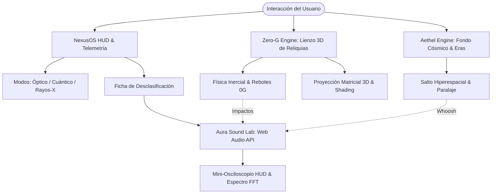

# AETHERIS 3050 — Deep-Time Human Vault & Cosmic Archive
> **El Archivo Terrestre del Año 3050: Cámara Holográfica de Preservación de la Humanidad**

[](https://github.com/HEROU7/aetheris-3050)
[](https://herou7.github.io/aetheris-3050/)
[](https://github.com/HEROU7/aetheris-3050)
[](https://github.com/HEROU7/aetheris-3050)
[](https://github.com/HEROU7/aetheris-3050)
[](LICENSE)

> 🚀 **Experiencia en Vivo Disponible:** [https://herou7.github.io/aetheris-3050/](https://herou7.github.io/aetheris-3050/)

---

## 1. Visión & Manifiesto

En el año **3050.284 (Stardate // 9821.4)**, tras milenios de expansión interestelar y dispersión de la biosfera terrestre, la estación orbital de preservación profunda **AETHERIS** salvaguarda los vestigios esenciales de la civilización humana.

**AETHERIS 3050** es una aplicación web interactiva inmersiva de alta fidelidad que recrea la consola holográfica de la bóveda. Combina cuatro dimensiones de interacción en tiempo real a **60 FPS estables**, ejecutándose de forma autónoma sin dependencias externas ni compiladores pesados:

1. **NexusOS:** Sistema operativo sci-fi de telemetría cuántica, reloj estelar dinámico y selector de espectros de visión.
2. **Zero-G Studio:** Cámara de contención antigravedad con reliquias 3D flotantes con físicas vectoriales interactivas (arrastrables, lanzables con inercia y con vista técnica explosionada).
3. **Aethel Engine (Cosmos):** Lienzo dinámico de polvo estelar, nebulosas procedurales y saltos temporales relativistas a través de las eras históricas de la humanidad.
4. **Aura Sound Lab:** Motor de audio procedural nativo (Web Audio API) con sintetizador de resonancias, zumbido ambiental de nave y analizador de espectro/osciloscopio en tiempo real.

---

## 2. Arquitectura del Sistema



---

## 3. Especificación Detallada de Módulos

### MÓDULO A: NexusOS (HUD & Telemetría Superior)
- **Cronología Estelar Activa:** Contador dinámico en tiempo real sincronizado a milisegundos (`AÑO 3050.xxx | STARDATE // xxxx.x`).
- **Integridad Cuántica:** Monitor pulsante del campo de confinamiento (99.8%) con micro-fluctuaciones de ruido entrópico.
- **Selector de Modos de Visión:**
  - `Luz Visible (Óptico)`: Espacio profundo obsidiana con acentos en cian y oro estelar.
  - `Escaneo Cuántico (Cyberpunk)`: Neones cian y violeta, mallas de energía holográficas y acentos de distorsión.
  - `Rayos-X / Wireframe (CRT)`: Monocromía militar verde fósforo (`#00ff88`), líneas de barrido scanline y retículas de radar polar.
- **Mini-Osciloscopio Reactivo:** Renderizado en `<canvas>` de la forma de onda de audio del master bus en tiempo real.

---

### MÓDULO B: Zero-G Studio (Cámara de Gravedad Cero & Reliquias 3D)
Renderizado puramente en `<canvas>` sin Three.js ni modelos GLTF pesados. Todos los objetos son generados proceduralmente mediante cálculo matricial 3D y renderizados a 60 FPS:

#### Reliquias Preservadas:
1. **El Disco de Oro de las Voyager (1977 D.C.):**
   - Fonógrafo de cobre bañado en oro con ranuras microscópicas grabadas en proyección 3D.
   - Vectorizado del mapa de los 14 púlsares con código binario y la transición hiperfina del átomo de hidrógeno.
   - Respaldo de uranio-238 para datación radiométrica interestelar.
2. **El Núcleo Cuántico Terra-1 (2088 D.C.):**
   - Jaula exterior de tesseract hiperdimensional con vértices luminiscentes.
   - Anillos cardán concéntricos (*gimbal rings*) girando independientemente sobre tres ejes.
   - Singularidad cuántica pulsante central con filamentos de energía entrelazada.
3. **Cristal Bio-Sintético Génesis (2540 D.C.):**
   - Bipirámide hexagonal con 12 facetas cristalinas translúcidas y sombreado basado en vectores normales y luz cenital virtual.
   - Núcleo de doble hélice bio-neural (ADN humano completo auto-reparable) rotando en su interior con nodos moleculares brillantes.

#### Física Interactiva:
- **Arrastre y Lanzamiento (Fling Physics):** Haz clic y arrastra cualquier reliquia con el ratón o dedo táctil. Al soltarla a gran velocidad, se le transfiere momento inercial y vuela rebotando elásticamente contra los límites de la cámara de contención (`restitution = 0.72`).
- **Rotación Libre 3D:** Arrastra el cursor sobre el espacio vacío para inspeccionar los artefactos en cualquier ángulo (Pitch, Yaw y Roll).
- **Control de Masa Gravitacional:**
  - `0G LIBRE`: Inercia espacial pura con deriva armónica senoidal (`sin(t * 1.5)`).
  - `1G TERRESTRE`: Gravedad estándar hacia el piso de contención con amortiguación y rebote.
  - `HIPER-MASA`: Alta densidad gravitatoria (`g = 1.15`), masa pesada y thud metálico al impactar.
- **Vista Explosionada (Inspect Mode):** Desensamble con animación elástica suave que separa el artefacto en sus capas funcionales con líneas de cota y etiquetas técnicas flotantes.

---

### MÓDULO C: Aethel Engine (Cosmos & Línea Temporal)
- **Fondo Estelar 3D:** Más de 550 estrellas con coordenadas `(x, y, z)` proyectadas con perspectiva de profundidad y velocidad relativa.
- **Nebulosas Procedurales:** Clústeres de gradientes radiales de múltiples octavas que derivan suavemente en el vacío.
- **Paralaje con Resortes:** Reacción elástica ultra-suave a la velocidad y posición del ratón (`spring = 0.06`).
- **Navegador de Eras Históricas:**
  - `Era Analógica (1900-1999)`: Atmósfera dorada/ámbar, polvo estelar cálido.
  - `Era Silicio (2000-2099)`: Plasma cian, cuadrículas de datos y destellos digitales.
  - `Era Post-Humana (2100-3050)`: Púrpura cósmico, filamentos de radiación Hawking y singularidades.
- **Salto Hiperespacial (Warp Jump):** Al cambiar de era, la cámara acelera relativisticamente estirando las estrellas en líneas de velocidad temporal con destellos cromáticos y desaceleración fluida.

---

### MÓDULO D: Dossier Panel (Ficha Holográfica de Desclasificación)
- Cajón lateral retráctil con efecto *glassmorphism* (`backdrop-filter: blur(24px)` y borde refractivo de 1px).
- Nivel de clasificación oficial (`CONFIDENCIAL // NIVEL OMEGA`).
- Matriz de especificaciones físicas: Composición material, masa inercial, firma cuántica ($\psi$) y porcentaje de integridad.
- Crónica histórica de ciencia ficción profunda.
- **Sintonizador de Resonancia Sonora:** Ejecuta el acorde armónico único de la reliquia y excita el analizador de espectro gráfico.

---

### MÓDULO E: Aura Sound Lab (Síntesis Procedural Web Audio API)
Todo sonido es generado en tiempo real mediante matemáticas acústicas nativas:
- **Drone de Cabina (55Hz / 110Hz):** Osciladores senoidales y triangulares con batido acústico, filtrados por un `BiquadFilterNode` modulado por un LFO ultra-lento (0.065 Hz) para simular la respiración de una estación espacial presurizada.
- **Ruido Rosa Atmosférico:** Síntesis matemática de ruido rosa (`b0, b1, b2`) para recrear el flujo de soporte vital.
- **SFX Hápticos:** Clics mecánicos agudos (2400Hz $\rightarrow$ 750Hz), barridos de escaneo holográfico y confirmaciones cromáticas.
- **Colisiones en 0G:** Campana metálica de bronce para Voyager, thud electromagnético para Terra-1 y carillón de cuarzo prístino para Génesis.
- **Salto Hiperespacial:** Rampa de frecuencia ascendente con resonancia en banda y liberación de energía en plasma blanco.

---

## 4. Fundamentos Matemáticos

### Proyección en Perspectiva 3D
Dado un punto tridimensional $P = (x, y, z)$ y una cámara situada a una distancia $d_{cam}$ con campo visual $FOV$:

$$k = \frac{FOV}{z + d_{cam}}$$

$$x_{screen} = x_{center} + x \cdot k$$

$$y_{screen} = y_{center} + y \cdot k$$

### Rotación Matricial Tridimensional (Euler Yaw-Pitch-Roll)
El punto $P$ rota alrededor de los tres ejes espaciales mediante matrices trigonométricas concatenadas:

$$P' = R_z(\theta_z) \cdot R_x(\theta_x) \cdot R_y(\theta_y) \cdot P$$

### Dinámica Inercial y Rebote Elástico
En cada fotograma $\Delta t$, la posición y velocidad se integran según:

$$\vec{v}_{t+\Delta t} = \vec{v}_t \cdot \mu + \vec{g} \cdot \Delta t$$

$$\vec{p}_{t+\Delta t} = \vec{p}_t + \vec{v}_{t+\Delta t} \cdot \Delta t$$

Donde $\mu$ representa el coeficiente de arrastre ambiental ($\mu_{0G} = 0.993$) y ante colisiones con los límites espaciales:

$$v_{impact} = -v \cdot \varepsilon \quad (\varepsilon = 0.72)$$

---

## 5. Atajos de Teclado (NexusOS Hotkeys)

| Tecla | Acción |
| :---: | :--- |
| `1` | Seleccionar **Disco de Oro de las Voyager (1977)** |
| `2` | Seleccionar **Núcleo Cuántico Terra-1 (2088)** |
| `3` | Seleccionar **Cristal Bio-Sintético Génesis (2540)** |
| `G` | Conmutar Modo de Gravedad (`0G Libre` $\rightarrow$ `1G` $\rightarrow$ `Hiper-Masa`) |
| `E` | Alternar **Vista Explosionada** (*Inspect Mode*) |
| `V` | Alternar Modo de Visión (`Luz Visible` $\rightarrow$ `Cuántico` $\rightarrow$ `Rayos-X CRT`) |
| `M` | Silenciar / Activar Audio Maestro (**Aura Synth**) |
| `D` | Abrir / Cerrar el **Expediente de Desclasificación** |
| `Espacio` | Recentrar reliquia en el origen de la cámara |

---

## 6. Instalación y Uso Local

No se requieren herramientas de compilación complejas ni bundlers (Webpack/Vite). Simplemente clona y ejecuta con cualquier servidor estático:

```bash
# 1. Clonar el repositorio
git clone https://github.com/TU_USUARIO/aetheris-3050.git
cd aetheris-3050

# 2. Servir con cualquier servidor HTTP local (ejemplo: npx serve o python)
npx serve . -p 3050
# o alternativamente:
python -m http.server 3050

# 3. Abrir en el navegador:
# http://localhost:3050
```

---

## 7. Estructura del Repositorio

```
aetheris-3050/
├── index.html          # Estructura semántica, lienzos y HUD NexusOS
├── styles.css          # Estilos HUD, tokens de color, glassmorphism y aceleración GPU
├── audio.js            # Aura Sound Lab: Web Audio API sintetizado proceduralmente
├── relics.js           # Zero-G Studio: Geometrías 3D, físicas inerciales y despiece
├── cosmos.js           # Aethel Engine: Estrellas 3D, nebulosas y salto hiperespacial
├── app.js              # Inicializador y orquestador reactivo de eventos
├── ARCHITECTURE.md     # Documentación técnica de arquitectura profunda
├── CONTRIBUTING.md     # Guía de contribución para desarrolladores
├── LICENSE             # Licencia de código abierto MIT
└── README.md           # Documento maestro del proyecto
```

---

## 8. Licencia

Distribuido bajo la **Licencia MIT**. Consulta [`LICENSE`](LICENSE) para más información.

*Diseñado y programado para los estándares más exigentes del diseño web interactivo de vanguardia.*
